<p align="center">
  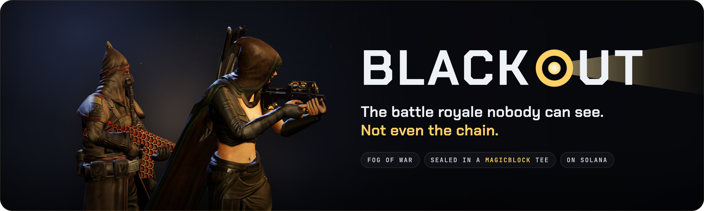
</p>

<h2 align="center">A real-time fog-of-war battle royale on MagicBlock</h2>

<p align="center">
  Nobody can see you: not the other players, not the RPC, not even the chain.<br>
  Every position lives in a sealed account inside MagicBlock's TEE rollup, and each player only receives what their own flashlight hits.
</p>

<p align="center">
  <a href="https://playblackout.fun"></a>
  <a href="https://explorer.solana.com/address/CkSb4kkmhzr8n9awdmrvqhuoWka6nZUXXb8RXnrFBAKU?cluster=devnet"></a>
  <a href="#how-it-uses-magicblock"></a>
</p>

<p align="center">
  
  
  
  
  
  <a href="https://x.com/magicblock/status/2110732865923383620"></a>
  <a href="https://superteam.fun/earn/listing/colosseum-crypto-worlds-fair-hackathon-superteam-india-track"></a>
  <a href="https://colosseum.com/arena/projects/blackout"></a>
</p>

<p align="center">
  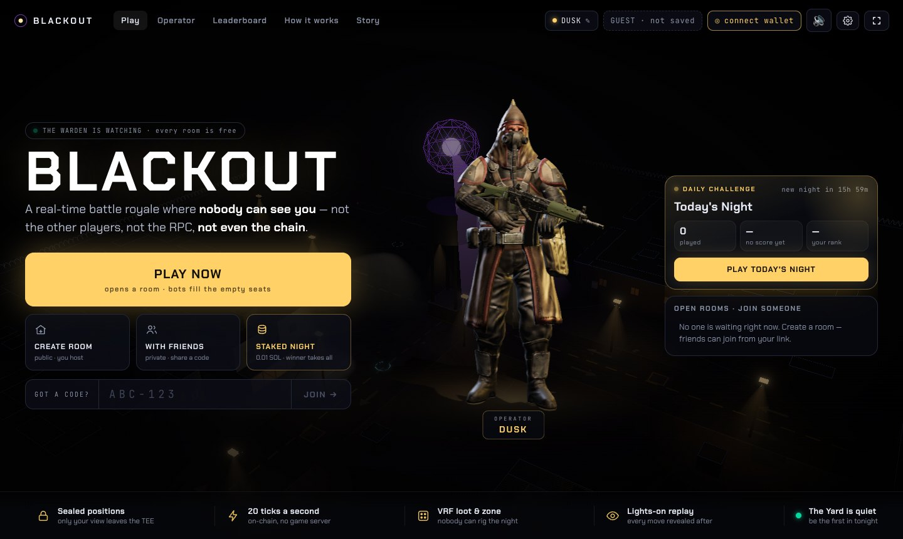
</p>

On a normal blockchain, fog of war is impossible: every account is public, so a wallhack is one RPC call. Dark Forest needed zero-knowledge proofs and was still turn-based. BLACKOUT runs each night at **20 ticks a second** inside a **MagicBlock Private Ephemeral Rollup** (an Intel TDX enclave), and uses **ephemeral permissions** to decide, account by account, who may read what. When the last player falls, the lights come on: the sealed World is flipped public, the full replay unlocks, and a **Magic Action** settles the night on Solana.

| | |
|---|---|
| Play | **[playblackout.fun](https://playblackout.fun)** (also [blackout.anshverma.tech](https://blackout.anshverma.tech)): free, gasless, no wallet needed |
| Program (devnet) | [`CkSb4kkmhzr8n9awdmrvqhuoWka6nZUXXb8RXnrFBAKU`](https://explorer.solana.com/address/CkSb4kkmhzr8n9awdmrvqhuoWka6nZUXXb8RXnrFBAKU?cluster=devnet) |
| TEE validator | [`MTEWGuqxUpYZGFJQcp8tLN7x5v9BSeoFHYWQQ3n3xzo`](https://explorer.solana.com/address/MTEWGuqxUpYZGFJQcp8tLN7x5v9BSeoFHYWQQ3n3xzo?cluster=devnet) (`devnet-tee.magicblock.app`) |
| Live proof | The **How it works** page has a *Try to cheat* button that asks the TEE for a real room's sealed accounts and shows the denial |
| Built with AI | How the game was built with Claude Code, from the first commit to now: [AI_USAGE.md](AI_USAGE.md) |
| Security | Self-audit of every path money can take, with the fixes: [Audit.md](Audit.md) |

### Hackathons

| Event | Status |
|---|---|
| **MagicBlock Solana Blitz v9** | 🥈 **Won 2nd place** · [announcement](https://x.com/magicblock/status/2110732865923383620) |
| **Superteam India track** · Colosseum Crypto World's Fair | [Listing](https://superteam.fun/earn/listing/colosseum-crypto-worlds-fair-hackathon-superteam-india-track) |
| **Colosseum Crypto World's Fair Hackathon** | [Project page](https://colosseum.com/arena/projects/blackout) |

---

## How it works

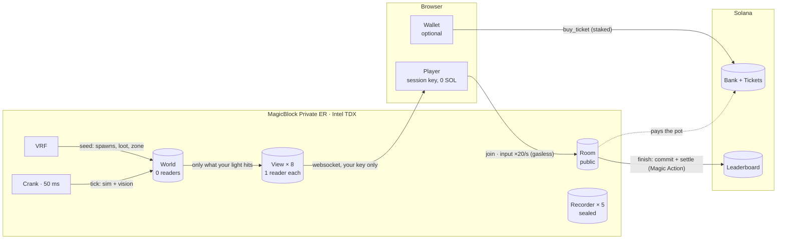

1. **Create or join a room.** The creator claims a free room and becomes its host. Public rooms are listed on the gate; private rooms get a 6-character code. Taking a seat calls `join`, which rewrites that seat's View permission so only your browser's session key can read it.
2. **The host sets the night.** Seats (2–8, empty seats become on-chain bots), bot skill (easy / medium / hard) and solo or duos. Every night is a fixed 5:00, and some roll a night modifier (fog, hunter's moon, sniper night, no lamps, gadget night). The host can hand the room over or kick a player; in a private room a kick also rotates the code.
3. **VRF rolls it.** `start_match` requests a MagicBlock VRF seed and schedules a crank. The callback derives spawns, loot contents and every zone centre straight into the sealed World.
4. **20 ticks a second, inside the TEE.** Every 50 ms `tick` runs inputs → movement → weapons → bullets → pickups → zone → deaths, then for each seat computes **vision** (a 77° flashlight cone with line-of-sight, a 2-tile "feel" circle, muzzle flashes that give shooters away, flares that reveal everyone) and **sound** (directional pings for footsteps, sprinting, gunshots and reloads you *can't* see; a crouched player makes no footsteps and is only seen at 70% range), and writes only that into the seat's private View.
5. **Lights on.** At the final kill, anyone calls `finish`: World and Recorder flip public, the seed becomes verifiable, the replay unlocks, and the room commits to Solana with the `settle` Magic Action, which pays the staked pot and writes the leaderboard.
6. **Reset.** `reset` re-seals everything for the next night on the same accounts.

### Inside one tick

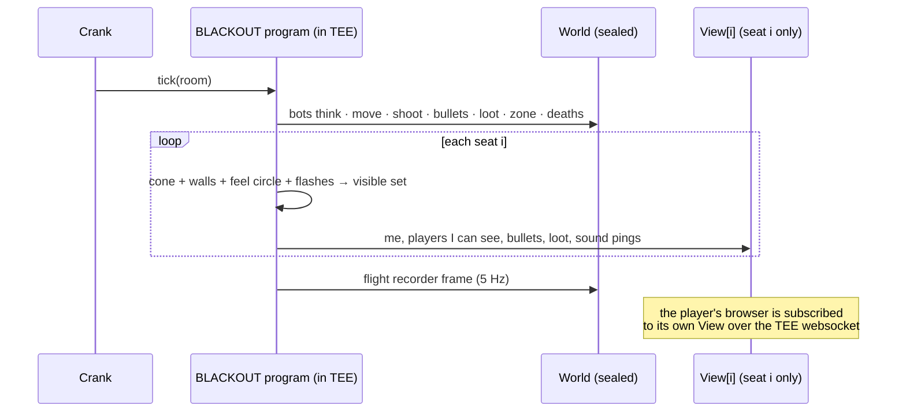

---

## How it uses MagicBlock

Take any one of these out and the game stops working.

| Building block | What it does in BLACKOUT |
|---|---|
| **Private Ephemeral Rollup** (TEE) | Runs the whole night: physics, bullets, bots, vision. Without it every position would be public state. |
| **Ephemeral permissions** | World has *zero* readers, each View has exactly one (its seat's key), Room has everyone. `join`, `kick` and `leave` rewrite View permissions; `finish` flips World + Recorder public and `reset` seals them again. |
| **Ephemeral accounts** | World, 8 Views and 5 Recorder chunks exist only inside the rollup, rent sponsored by the room PDA. Over 60 KB of per-night state never touches the base layer. |
| **Crank** | `start_match` schedules `tick` every 50 ms. There is no game server anywhere. |
| **VRF** | One seed per night rolls spawns, loot and every zone centre, sealed until each circle is announced, published at lights-on. |
| **Magic Action** | `finish` commits the room with a post-commit `settle` action that pays the pot from the room's bank and writes the leaderboard, with no extra user transaction. |
| **Gasless session keys** | Your browser makes a key with 0 SOL; every move, shot and heartbeat is signed silently, about 20 a second, with no wallet popup. |
| **Delegation + commit** | Room PDAs live on Solana, are delegated to the TEE validator for play and committed back after each night. Bank, tickets and leaderboard stay on L1. |

### Who can read what

| | You | Other players | Spectators · RPC | After lights-on |
|---|:-:|:-:|:-:|:-:|
| Room: names, alive count, kill feed, current zone | ✓ | ✓ | ✓ | ✓ |
| Your View: you + what your flashlight hits | ✓ | ✕ | ✕ | ✓ |
| World: every position, bullet and loot crate | ✕ | ✕ | ✕ | ✓ |
| VRF seed and future zone circles | ✕ | ✕ | ✕ | ✓ |
| Flight recorder (the replay) | ✕ | ✕ | ✕ | ✓ |

No ghosting: when you die your View is emptied. Bots follow the same vision rules, inside the TEE.

---

## The game

<p align="center">
  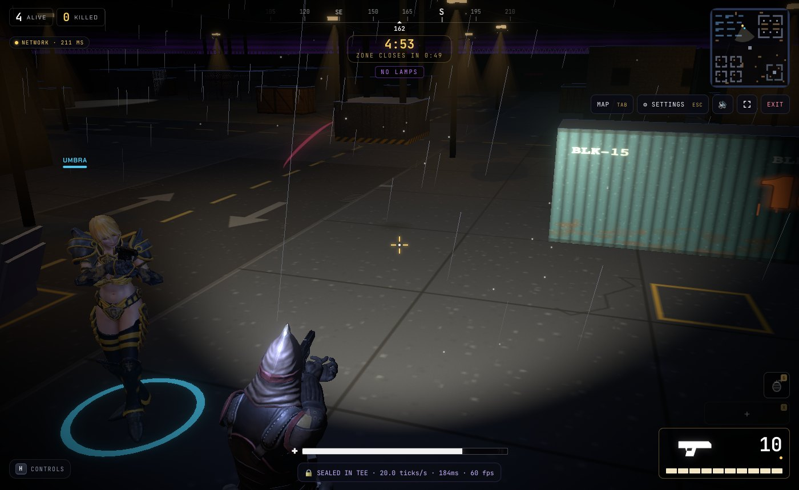
</p>

### The story

First-time visitors get a one-minute narrated story, told by DUSK over a single night: eight operators wake in the Yard with no lights, the circle pushes the last of them out into the Meadow, and one walks out. It plays live in the engine with the game's own operators, guns, recorded deaths and sound, so everything it shows is how the game really works: a torch gives you away, every shot is a flare, the grass hides you and the crossbow makes no sound. Skip it with **skip ›**, or replay it any time from **Story** in the top bar.

<p align="center">
  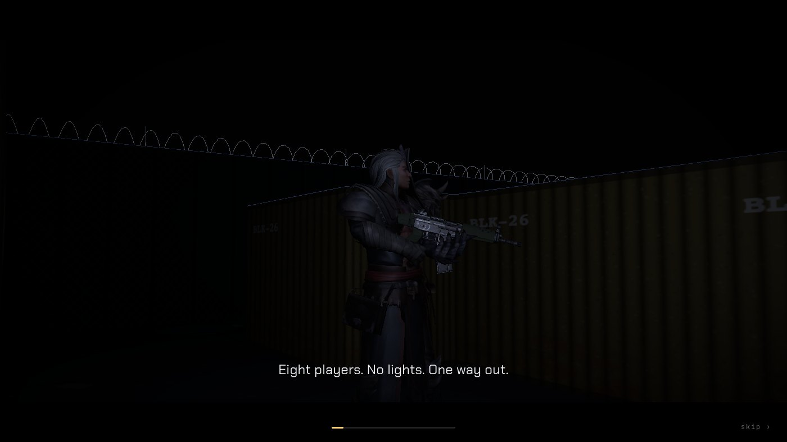
</p>

### Two maps

The host picks the map in the lobby.

| | |
|---|---|
| **The Yard** | Containers, warehouses, offices and floodlights. Tight corners, and a lamp on every crossroads. |
| **The Meadow** | Open fields, hedgerows, a creek and a bridge. Tall grass hides anyone crouched or prone in it, and one crate a night holds a **ghillie suit**: crouch in it and you're only seen up close. |

<p align="center">
  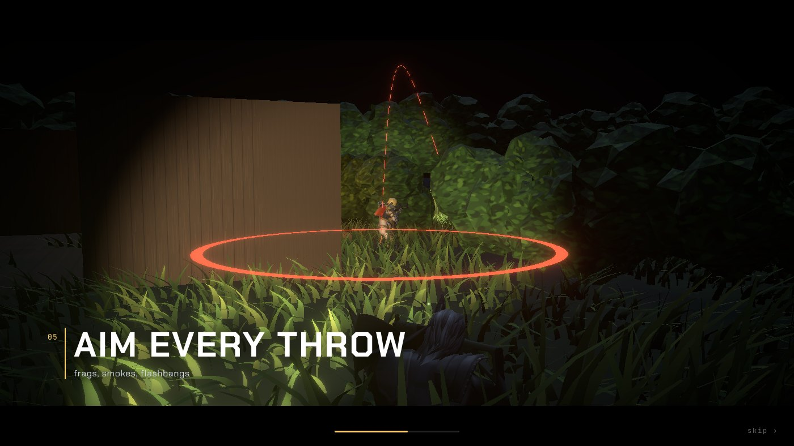
</p>

### Your operator

The **Operator** page sets how everyone at your table sees you. It's saved on your device and travels inside three spare bytes of your on-chain name, so it needs no extra accounts.

- **Operators:** six motion-captured soldiers (TITAN, GRIM, VIPER, ECHO, NOX, VEIL), sharing 41 recorded animations: idle, walk, run and strafe, crouch, prone crawl, jump and dive roll, reloads by stance, throws, hits, emotes and six different deaths.
- **Outfits:** seven tones for your gear (Original, Woodland, Desert, Urban, Midnight, Arctic, Crimson).
- **Emotes:** Salute, Victory, Wave, Taunt, Dance and Clap. Press **B** in a night for the emote wheel, or click your soldier in the lobby.
- **Gunsmith:** turn any of the eight guns on a stand, compare damage, fire rate, magazine and range, and pick a metal finish (six) and a skin (seven: Factory, Woodland, Digital, Tiger, Carbon, Hex, Ember). Both apply to every gun you carry.

<p align="center">
  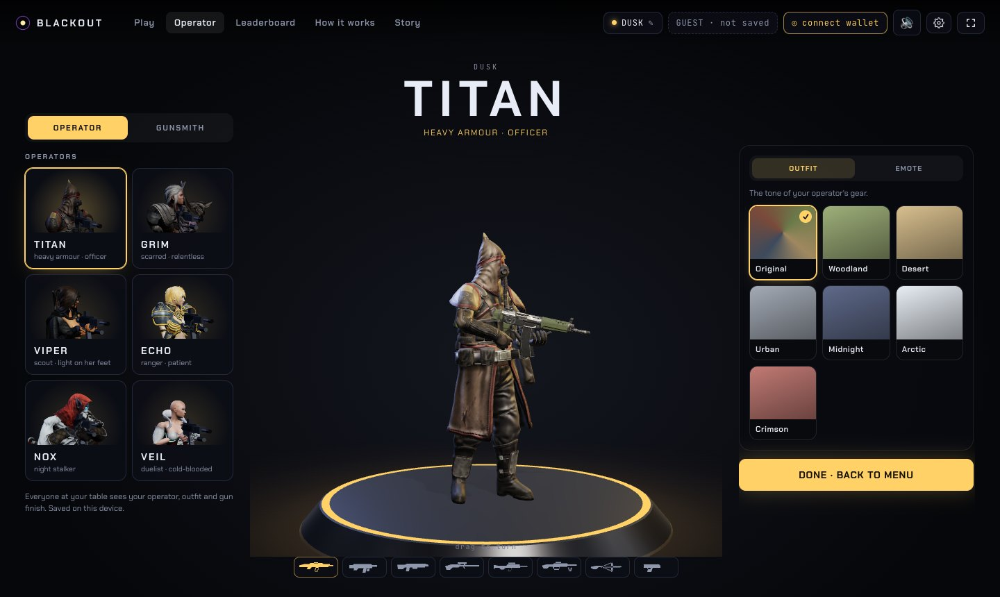
  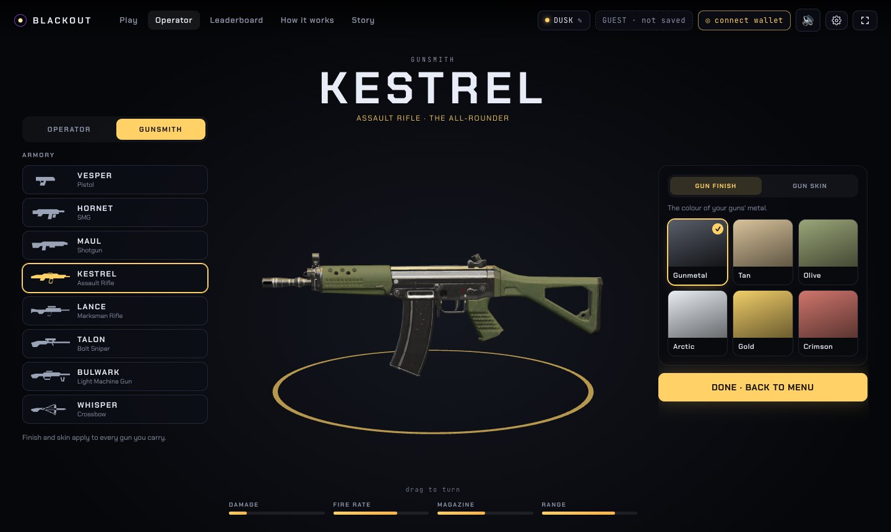
</p>

### How a night plays

| | |
|---|---|
| **Stealth first** | You see only your flashlight cone. Shooting lights you up for everyone nearby; footsteps, reloads and loot pickups make directional sound pings. |
| **Move** | Shift sprints (1.5×, loud, burns stamina), C crouches to sneak (slow and silent), Ctrl goes prone (a crawl, seen at under half the usual range), Space jumps. Stamina, crouch, prone and jump are simulated on-chain and mirrored bit-for-bit for prediction. |
| **Guns** | eight original guns: VESPER pistol, HORNET SMG, MAUL shotgun, KESTREL rifle, TALON sniper, LANCE marksman rifle, BULWARK LMG and the silent WHISPER crossbow; two slots, aim down sights, recoil. Seven are real CC-BY models, held in both hands along the recorded grip. Each has its own layered sound: crack, body, tail, and the slide, pump or bolt. |
| **Gadgets** | Frag, smoke, flashbang, decoy, motion sensor and night vision. Hold G to see the arc and where it lands, let go to throw. The can flies, bounces off walls and rolls on-chain; you see and hear it. |
| **Daily challenge** | A daily prize at the 0.05 SOL table: 2% of every pot there goes into the day's pot (the house keeps 3%). Play 3 nights and beat as many *different* players as you can; the most players beaten wins the pot (net profit breaks ties). The prize waits for the winner until they claim it: no deadline. |
| **Events** | Supply drops, a mid-night BLACKOUT that kills the lamps, and a bounty on the kill leader. |
| **Duos** | Partners see each other through walls, get downed instead of dying, and revive by standing over each other. |
| **Loot** | Medkits, armor, every gun and gadget above, and the flare, which lets you see everyone for 5 seconds. Supply drops carry the best of it. |
| **The zone** | Three shrinking circles with rising damage, timed to the 5:00 night. The next circle is sealed until it's announced. |
| **Bots** | Empty seats become on-chain bots with the same vision and hearing as you. The host picks easy, medium or hard. |
| **Storm** | Rain, and lightning that lights up the walls (never the players). Thunder rolls in a second later. |
| **Sound** | Real recorded gunshots, reloads and racks, horror ambience under every night, and horror hits when someone steps into your light, when you die and when the lamps die. All CC0, credited in `app/public/sfx/CREDITS.txt`. Master, effects and music volume each go to 150%. |
| **Feel** | Tracers, sparks and blood, hit markers, kill streak banners, recoil and hit shake, a sprint camera, walls that fade when they block your view. |
| **Death** | One of six recorded deaths (falling back, forward, a headshot, a crouched collapse…), the gun clatters away and the dropped torch lights the body while the camera rises. Players you watch die stay where they fell. |
| **Controls** | A controls card (H) in five groups: move, stealth, combat, gear, view and menu, and prompts appear only when a key matters: reload on an empty mag, how to throw a new gadget, swap to a new gun. |
| **Replay** | After lights-on, scrub the whole night from your own view or everyone's, follow any player, and export a clip. |

<p align="center">
  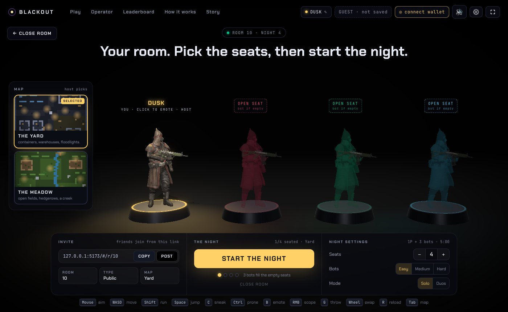
  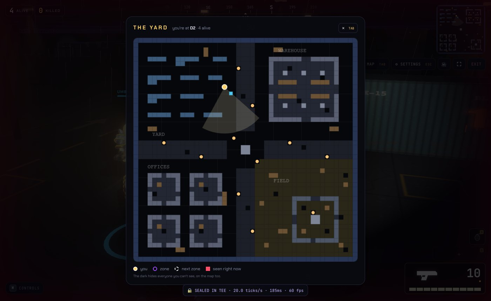
</p>
<p align="center">
  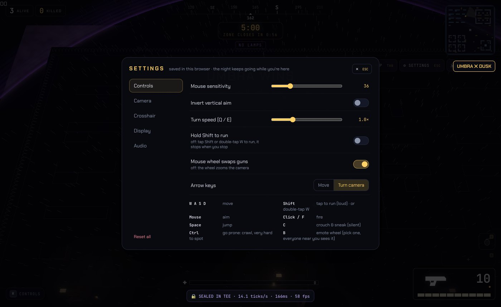
  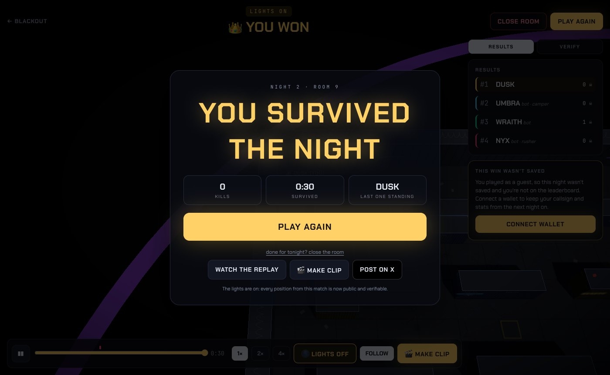
</p>
<p align="center">
  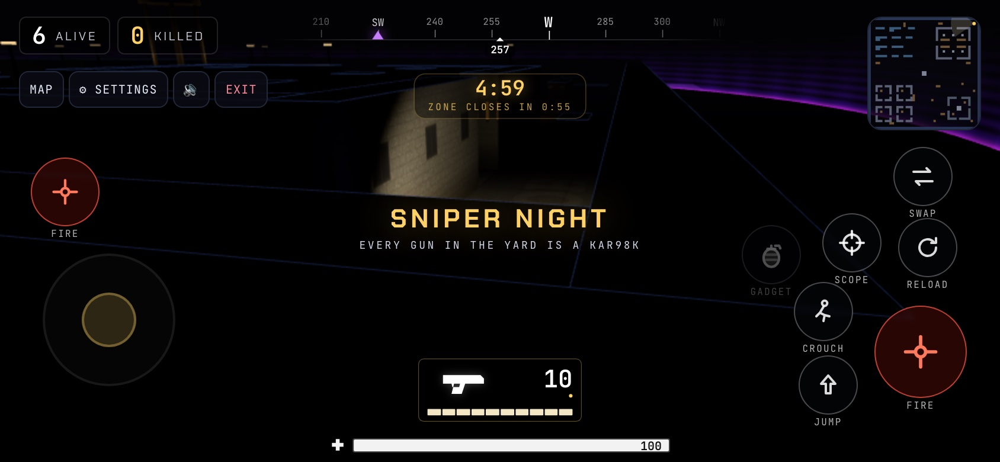
</p>

| Screen | What's there |
|---|---|
| Home | Play now, create a room, play with friends (private, with a code), the staked night (choose your table), join by code, the daily challenge with today's prize pot, and open rooms, beside your own operator |
| Operator | Pick an operator, outfit and emote; the Gunsmith for finishes and skins |
| Lobby | Map picker, 3D pedestals per seat (click yours to emote), host controls (seats, bot skill, solo or duos, make host, kick), invite link or room code |
| Match | Compass, countdown clock with the zone schedule, minimap and full map (Tab), a fullscreen button (phones go fullscreen and sideways on their own), phone controls (move stick, drag to look, labelled fire/scope/jump/crouch/reload/swap/gadget buttons), the emote wheel (B), settings (Esc) in five tabs: controls, camera, crosshair, display and audio |
| Verdict | Results, replay, clip export, and a VERIFY tab that re-derives the night from its VRF seed in your browser |
| Leaderboard | The daily challenge's top 10 and yesterday's winner, and every staked player (60 kept on chain), 20 a page (written by the `settle` Magic Action) |
| How it works | The live *Try to cheat* console, every building block, the timeline and the permission matrix |

**Wallet optional.** Guests play free and gasless with a browser key; nothing is saved and they never appear on the leaderboard. Connecting Phantom, Solflare or Backpack keeps your callsign and lets you play **staked nights**: pick a 0.01 or 0.05 SOL table, every staker pays the same stake into its bank, there are no bots and no host (a full table starts at once, otherwise a minute after the last staker sits down), the map is drawn from the night's randomness, and the Magic Action pays the winner the pot less a 5% house fee. Stakes aren't refunded: a ticket that wasn't used (you left the lobby, or a night was called off) carries over to a later night at the same stake.

---

## Verified on devnet

- `scripts/e2e.ts` plays full nights against the live TEE and checks that a player can read its own View but not another's, a spectator can't read the World, VRF seeds the match, the crank holds 20 ticks/s, and after `finish` the World and Recorder are readable and `settle` runs.
- `scripts/e2e_money.ts` (all pass) and `scripts/e2e_lobby.ts` (12/12): stakes, payouts, the fee, the daily prize, the table fund, carried-over tickets, lobby time limits and every attack from [Audit.md](Audit.md).
- `scripts/e2e_stake.ts`: two funded players buy tickets on Solana, play a staked night, and the winner's wallet receives the pot from the `settle` Magic Action.
- `scripts/mirror.ts`: 2,000 random movement steps (sprint, sneak, prone, jump and stamina included) and 72 aimed throws give identical results in the Rust program and the TypeScript prediction.
- `cargo test`: 44 tests (plus 2 long ones run on demand), including a golden fingerprint of whole nights, full 8-bot nights with valid placements, bots that actually fight, frags, duos revives, supply drops, the blackout, the house fee and called-off staked nights.
- After every night, the VERIFY tab re-derives every spawn, loot roll and zone circle from the revealed VRF seed and checks them against the unsealed World.
- `scripts/ui/`: Playwright runs of the full flows (and `readme_shots.ts`, which retakes every image in this README): guest play, private rooms with codes and kicks, closing a room, ending a night, duos, the phone layout and touch controls, and a console-error audit.

## Repository

```
programs/blackout/       Anchor program
  src/lib.rs             the list of instructions (thin: each calls its handler)
  src/config.rs          addresses, fee, timings
  src/state.rs           account layouts
  src/error.rs           error codes
  src/instructions/      admin, stake (money, prize, table fund), setup, lobby, night, room_account
  src/sim/               deterministic simulation: rules, math, seed, step, sight, bots, recorder, tests
  src/gen.rs             map and trig tables (generated by scripts/gen.py)
app/                     Vite + React + react-three-fiber client
  src/chain/             instruction builders and account decoders
  src/game/              session (prediction, reconcile), sim.ts mirror, audio, settings
  src/scene/             the Yard and the Meadow, soldiers and guns, the story, effects, replay
  src/ui/                home, operator, lobby, HUD, emote wheel, verdict, leaderboard, how it works
  public/models/         operators, the shared animation bundle, gun models (credits in guns/CREDITS.md)
scripts/                 devnet tooling: deploy, admin, e2e, mirror, verify, kick stuck rooms
scripts/ui/              Playwright flow tests
docs/assets/             README images
```

How the game was built, and how each part was checked: [AI_USAGE.md](AI_USAGE.md).

## Run it

The client talks to the live devnet program, so to work on the game you only need Node 22+:

```bash
cd app
cp .env.example .env   # optional: point at your own RPC or program
npm install
npm run dev            # http://localhost:5173
```

To work on the program you also need Rust, the Solana CLI (3.x) and Anchor 1.0:

```bash
cd programs/blackout && cargo test && cd ../..   # simulation and money rules
npm install                                       # root: tooling for the scripts
npx tsx scripts/mirror.ts                         # Rust and TypeScript sims still agree
./scripts/deploy.sh                               # cargo build-sbf + anchor idl build (not `anchor build`), then deploy
```

Deploying your own copy needs your own program id and admin key: see [CONTRIBUTING.md](CONTRIBUTING.md#running-your-own-program).

## Limits

- **Devnet only.** Staked nights use devnet SOL. A mainnet build is prepared but not deployed.
- **The TEE is the trust anchor.** Privacy rests on MagicBlock's TDX validator and its permission checks; the program can't prove privacy by itself.
- **Fixed room pool.** Rooms are pre-created slots that players claim; a room with nobody in it is finished and reset by the next visitor.

## Contributing

Bug reports, playtest notes and pull requests are welcome. [CONTRIBUTING.md](CONTRIBUTING.md) explains how the pieces fit together and the one rule that matters most: the Rust simulation and its TypeScript mirror must change together. Found a way to cheat or to move someone else's SOL? Please report it privately, as described in [SECURITY.md](SECURITY.md).

## License

The code is [MIT](LICENSE). The characters and animations (Adobe Mixamo), gun models (CC-BY, see [credits](app/public/models/guns/CREDITS.md)) and sounds (CC0, see [credits](app/public/sfx/CREDITS.txt)) keep their own terms and are not covered by the MIT license.
