<p align="center">
  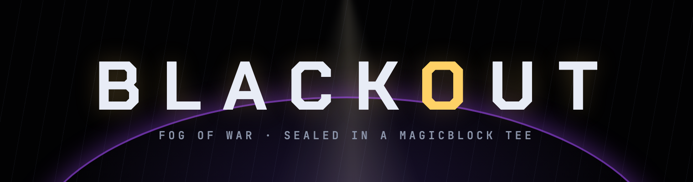
</p>

<h2 align="center">A real-time fog-of-war battle royale on MagicBlock</h2>

<p align="center">
  Nobody can see you: not the other players, not the RPC, not even the chain.<br>
  Every position lives in a sealed account inside MagicBlock's TEE rollup, and each player only receives what their own flashlight hits.
</p>

<p align="center">
  <a href="https://blackout.anshverma.tech"></a>
  <a href="https://explorer.solana.com/address/VWHcbCSH4kATcuPJgjZ6QC56W3NBQ53U6fxJNtGknh3?cluster=devnet"></a>
  <a href="#how-it-uses-magicblock"></a>
</p>

<p align="center">
  
  
  
  
  
  <a href="https://x.com/magicblock/status/2110732865923383620"></a>
  <a href="https://superteam.fun/earn/listing/colosseum-crypto-worlds-fair-hackathon-superteam-india-track"></a>
  <a href="https://colosseum.com/arena/projects/blackout"></a>
</p>

<p align="center">
  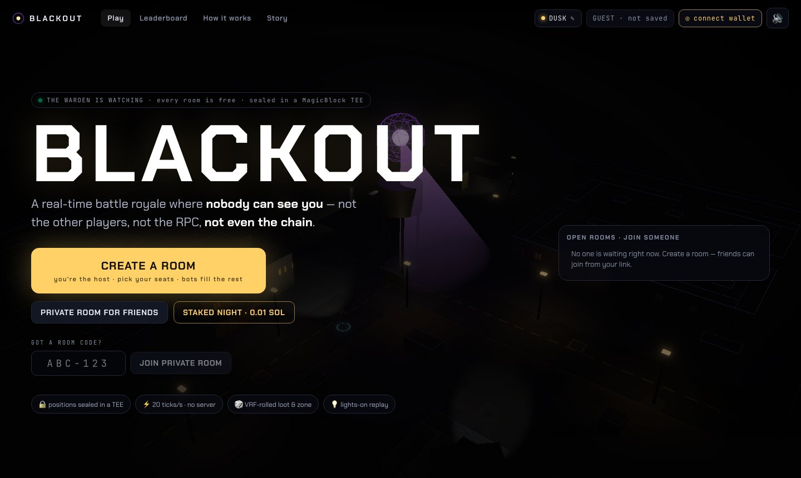
</p>

On a normal blockchain, fog of war is impossible: every account is public, so a wallhack is one RPC call. Dark Forest needed zero-knowledge proofs and was still turn-based. BLACKOUT runs each night at **20 ticks a second** inside a **MagicBlock Private Ephemeral Rollup** (an Intel TDX enclave), and uses **ephemeral permissions** to decide, account by account, who may read what. When the last player falls, the lights come on: the sealed World is flipped public, the full replay unlocks, and a **Magic Action** settles the night on Solana.

| | |
|---|---|
| Play | **[blackout.anshverma.tech](https://blackout.anshverma.tech)**: free, gasless, no wallet needed |
| Program (devnet) | [`VWHcbCSH4kATcuPJgjZ6QC56W3NBQ53U6fxJNtGknh3`](https://explorer.solana.com/address/VWHcbCSH4kATcuPJgjZ6QC56W3NBQ53U6fxJNtGknh3?cluster=devnet) |
| TEE validator | [`MTEWGuqxUpYZGFJQcp8tLN7x5v9BSeoFHYWQQ3n3xzo`](https://explorer.solana.com/address/MTEWGuqxUpYZGFJQcp8tLN7x5v9BSeoFHYWQQ3n3xzo?cluster=devnet) (`devnet-tee.magicblock.app`) |
| Live proof | The **How it works** page has a *Try to cheat* button that asks the TEE for a real room's sealed accounts and shows the denial |

### Hackathons

| Event | Status |
|---|---|
| **MagicBlock Solana Blitz v9** | 🥈 **Won 2nd place** · [announcement](https://x.com/magicblock/status/2110732865923383620) |
| **Superteam India track** · Colosseum Crypto World's Fair | [Listing](https://superteam.fun/earn/listing/colosseum-crypto-worlds-fair-hackathon-superteam-india-track) |
| **Colosseum Crypto World's Fair Hackathon** | [Project page](https://colosseum.com/arena/projects/blackout) |

---

## How it works

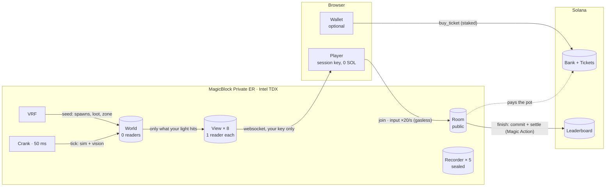

1. **Create or join a room.** The creator claims a free room and becomes its host. Public rooms are listed on the gate; private rooms get a 6-character code. Taking a seat calls `join`, which rewrites that seat's View permission so only your browser's session key can read it.
2. **The host sets the night.** Seats (2–8, empty seats become on-chain bots), bot skill (easy / medium / hard) and solo or duos. Every night is a fixed 5:00, and some roll a night modifier (fog, hunter's moon, sniper night, no lamps, gadget night). The host can hand the room over or kick a player; in a private room a kick also rotates the code.
3. **VRF rolls it.** `start_match` requests a MagicBlock VRF seed and schedules a crank. The callback derives spawns, loot contents and every zone centre straight into the sealed World.
4. **20 ticks a second, inside the TEE.** Every 50 ms `tick` runs inputs → movement → weapons → bullets → pickups → zone → deaths, then for each seat computes **vision** (a 77° flashlight cone with line-of-sight, a 2-tile "feel" circle, muzzle flashes that give shooters away, flares that reveal everyone) and **sound** (directional pings for footsteps, sprinting, gunshots and reloads you *can't* see; a crouched player makes no footsteps and is only seen at 70% range), and writes only that into the seat's private View.
5. **Lights on.** At the final kill, anyone calls `finish`: World and Recorder flip public, the seed becomes verifiable, the replay unlocks, and the room commits to Solana with the `settle` Magic Action, which pays the staked pot and writes the leaderboard.
6. **Reset.** `reset` re-seals everything for the next night on the same accounts.

### Inside one tick

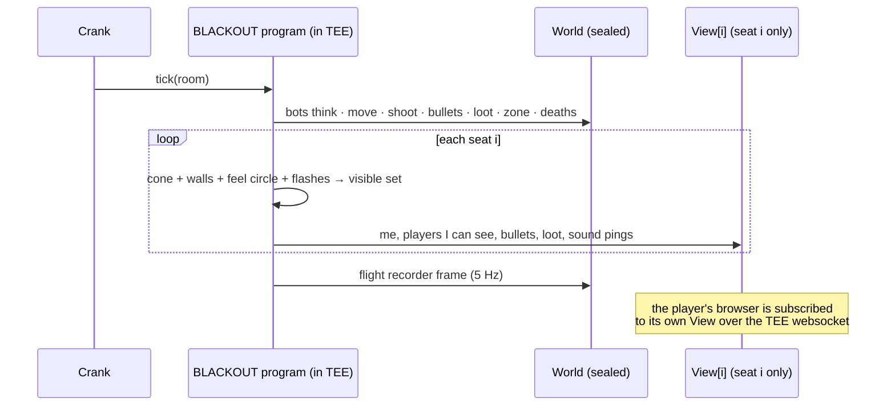

---

## How it uses MagicBlock

Take any one of these out and the game stops working.

| Building block | What it does in BLACKOUT |
|---|---|
| **Private Ephemeral Rollup** (TEE) | Runs the whole night: physics, bullets, bots, vision. Without it every position would be public state. |
| **Ephemeral permissions** | World has *zero* readers, each View has exactly one (its seat's key), Room has everyone. `join`, `kick` and `leave` rewrite View permissions; `finish` flips World + Recorder public and `reset` seals them again. |
| **Ephemeral accounts** | World, 8 Views and 5 Recorder chunks exist only inside the rollup, rent sponsored by the room PDA. Over 50 KB of per-night state never touches the base layer. |
| **Crank** | `start_match` schedules `tick` every 50 ms. There is no game server anywhere. |
| **VRF** | One seed per night rolls spawns, loot and every zone centre, sealed until each circle is announced, published at lights-on. |
| **Magic Action** | `finish` commits the room with a post-commit `settle` action that pays the pot from the room's bank and writes the leaderboard, with no extra user transaction. |
| **Gasless session keys** | Your browser makes a key with 0 SOL; every move, shot and heartbeat is signed silently, about 20 a second, with no wallet popup. |
| **Delegation + commit** | Room PDAs live on Solana, are delegated to the TEE validator for play and committed back after each night. Bank, tickets and leaderboard stay on L1. |

### Who can read what

| | You | Other players | Spectators · RPC | After lights-on |
|---|:-:|:-:|:-:|:-:|
| Room: names, alive count, kill feed, current zone | ✓ | ✓ | ✓ | ✓ |
| Your View: you + what your flashlight hits | ✓ | ✕ | ✕ | ✓ |
| World: every position, bullet and loot crate | ✕ | ✕ | ✕ | ✓ |
| VRF seed and future zone circles | ✕ | ✕ | ✕ | ✓ |
| Flight recorder (the replay) | ✕ | ✕ | ✕ | ✓ |

No ghosting: when you die your View is emptied. Bots follow the same vision rules, inside the TEE.

---

## The game

<p align="center">
  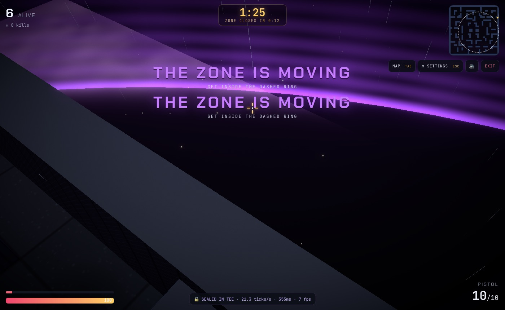
</p>

### The story

First-time visitors get a 50-second trailer, played live in the real Yard with the game's own soldiers, lights and sound. At 03:12 the grid fails and eight strangers wake in the Yard. DUSK learns the one rule by hiding behind a container while NYX's torch sweeps past: a light shows you the way, and shows everyone else where you are. He watches WRAITH spray at a sound and get picked off from the dark. The Warden watches it all and tells no one. The zone closes in, DUSK throws a frag, and he wins the last duel by staying dark and letting the light come to him. Replay it any time from **Story** in the top bar.

<p align="center">
  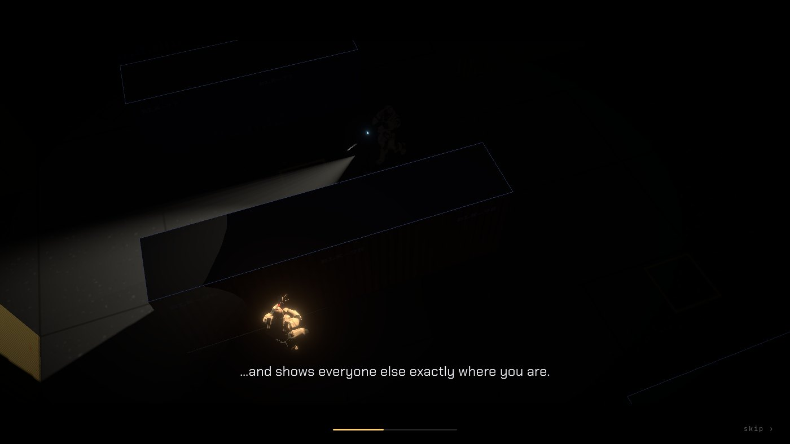
</p>

| | |
|---|---|
| **Stealth first** | You see only your flashlight cone. Shooting lights you up for everyone nearby; footsteps, reloads and loot pickups make directional sound pings. |
| **Move** | Shift sprints (1.5×, loud, burns stamina), C crouches to sneak (slow and silent), Space jumps. Stamina, crouch and jump are simulated on-chain and mirrored bit-for-bit for prediction. |
| **Guns** | P92, UMP, S12K, M416 and Kar98k, two slots, aim down sights, recoil. Each has its own layered sound: crack, body, tail, and the slide, pump or bolt. |
| **Gadgets** | Frag, smoke, flashbang, decoy, motion sensor and night vision. Hold G to see the arc and where it lands, let go to throw. The can flies, bounces off walls and rolls on-chain; you see and hear it. |
| **Events** | Supply drops, a mid-night BLACKOUT that kills the lamps, and a bounty on the kill leader. |
| **Duos** | Partners see each other through walls, get downed instead of dying, and revive by standing over each other. |
| **Loot** | Medkits, armor, every gun and gadget above, and the flare, which lets you see everyone for 5 seconds. Supply drops carry the best of it. |
| **The zone** | Three shrinking circles with rising damage, timed to the 5:00 night. The next circle is sealed until it's announced. |
| **Bots** | Empty seats become on-chain bots with the same vision and hearing as you. The host picks easy, medium or hard. |
| **Storm** | Rain, and lightning that lights up the walls (never the players). Thunder rolls in a second later. |
| **Sound** | Real recorded gunshots, reloads and racks, horror ambience under every night, and horror hits when someone steps into your light, when you die and when the lamps die. All CC0, credited in `app/public/sfx/CREDITS.txt`. Master, effects and music volume each go to 150%. |
| **Feel** | Tracers, sparks and blood, hit markers, kill streak banners, recoil and hit shake, a sprint camera, walls that fade when they block your view. |
| **Death** | The body buckles and falls back, the gun clatters away and the dropped torch lights it on the ground while the camera rises. Players you watch die stay where they fell. |
| **Controls** | A key card opens at the start of every night (H brings it back), and prompts appear only when a key matters: reload on an empty mag, how to throw a new gadget, swap to a new gun. |
| **Replay** | After lights-on, scrub the whole night from your own view or everyone's, follow any player, and export a clip. |

<p align="center">
  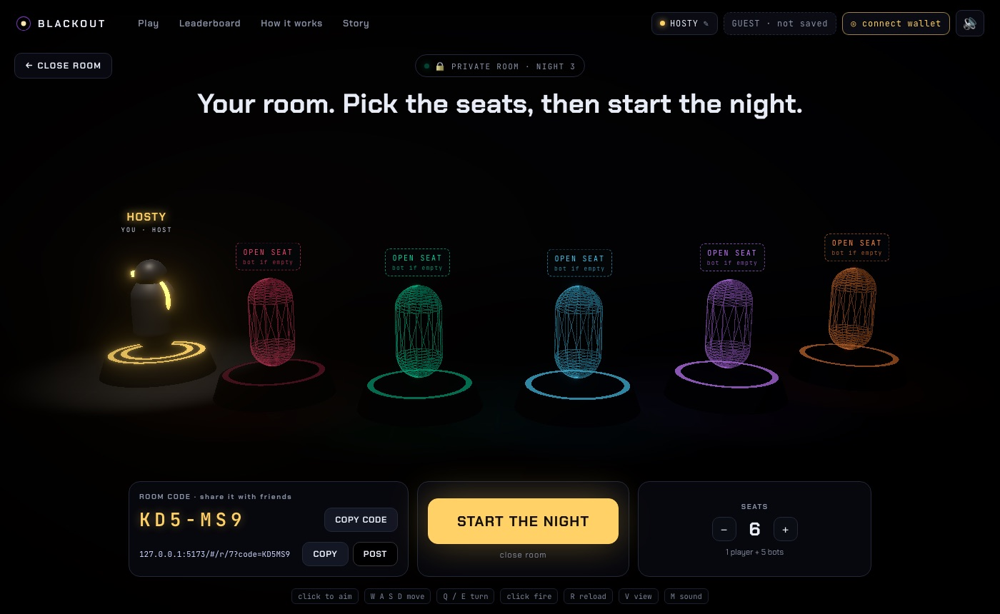
  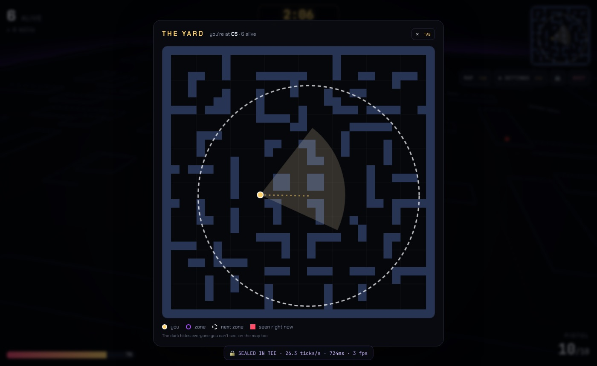
</p>
<p align="center">
  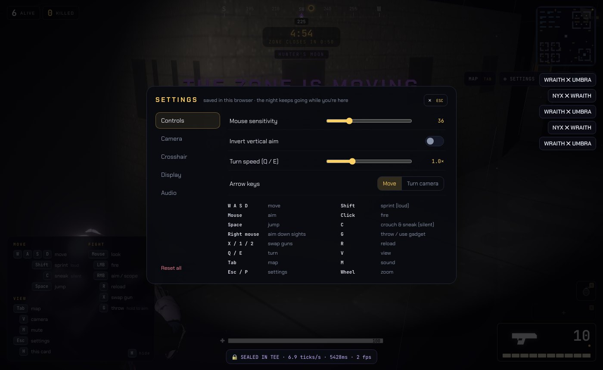
  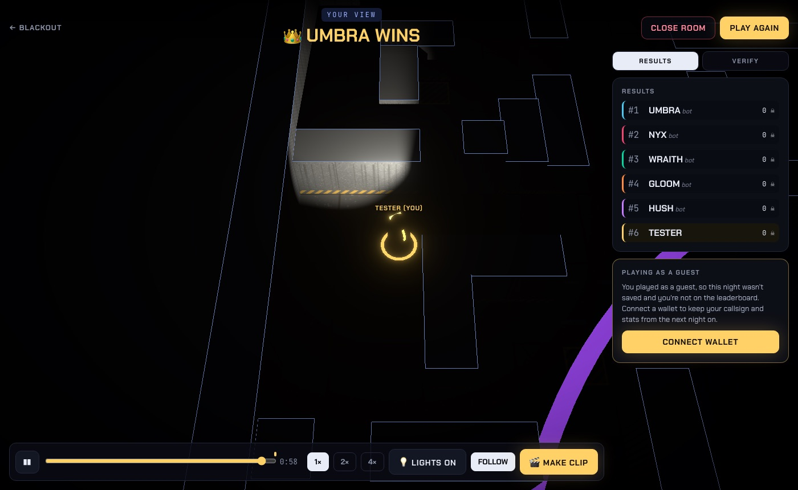
</p>
<p align="center">
  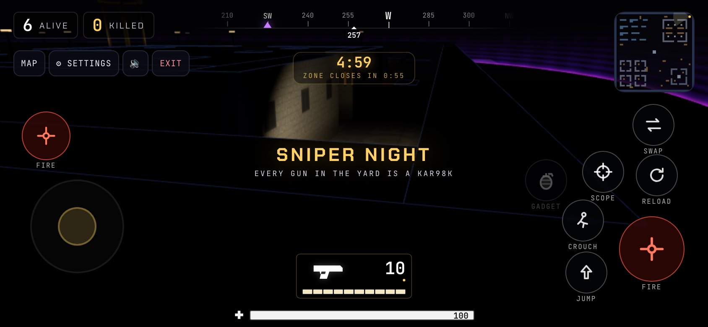
</p>

| Screen | What's there |
|---|---|
| Gate | Create a room, a private room with a code, join by code, the staked table, open rooms to join |
| Lobby | 3D pedestals per seat, host controls (seats, bot skill, solo or duos, make host, kick), invite link or room code |
| Match | Countdown clock with the zone schedule, minimap and full map (Tab), a fullscreen button (phones go fullscreen and sideways on their own), phone controls (move stick, drag to look, labelled fire/scope/jump/crouch/reload/swap/gadget buttons), settings (Esc): sensitivity, invert, arrow-key camera, FOV, smoothing, crosshair style/colour/size, laser sight, graphics, storm, master / effects / music volume |
| Verdict | Results, replay, clip export, and a VERIFY tab that re-derives the night from its VRF seed in your browser |
| Leaderboard | Staked nights only: wins and SOL won, written by the `settle` Magic Action |
| How it works | The live *Try to cheat* console, every building block, the timeline and the permission matrix |

**Wallet optional.** Guests play free and gasless with a browser key; nothing is saved and they never appear on the leaderboard. Connecting Phantom, Solflare or Backpack keeps your callsign and lets you play **staked nights**: every staker pays 0.01 SOL into the room's bank, there are no bots, and the winner's wallet is paid by the Magic Action.

---

## Verified on devnet

- `scripts/e2e.ts` plays full nights against the live TEE and checks that a player can read its own View but not another's, a spectator can't read the World, VRF seeds the match, the crank holds 20 ticks/s, and after `finish` the World and Recorder are readable and `settle` runs.
- `scripts/e2e_stake.ts`: two funded players buy tickets on Solana, play a staked night, and the winner's wallet receives the pot from the `settle` Magic Action.
- `scripts/mirror.ts`: 2,000 random movement steps, sprint, sneak, jump and stamina included, give identical results in the Rust program and the TypeScript prediction.
- `cargo test`: 40 full 8-bot nights end with valid placements; 30 more check bots actually fight; frags, duos revives, supply drops and the blackout each have a test.
- After every night, the VERIFY tab re-derives every spawn, loot roll and zone circle from the revealed VRF seed and checks them against the unsealed World.
- `scripts/ui/`: Playwright runs of the full flows (and `readme_shots.ts`, which retakes every image in this README): guest play, private rooms with codes and kicks, closing a room, ending a night, duos, the phone layout and touch controls, and a console-error audit.

## Repository

```
programs/blackout/       Anchor program
  src/lib.rs             28 instructions: rooms, lobby, match, settle (Magic Action)
  src/sim.rs             deterministic integer simulation + vision + bots + recorder, with tests
  src/state.rs           Room, World, View, Recorder, Board layouts
  src/gen.rs             map and trig tables (generated)
app/                     Vite + React + react-three-fiber client
  src/chain/             instruction builders and account decoders
  src/game/              session (prediction, reconcile), sim.ts mirror, audio, settings
  src/scene/             the Yard, players, effects, replay
  src/ui/                gate, lobby, HUD, verdict, leaderboard, how it works
scripts/                 devnet tooling: deploy, admin, e2e, mirror, verify, kick stuck rooms
scripts/ui/              Playwright flow tests
```

## Run it

```bash
# program (devnet)
anchor build && ./scripts/deploy.sh
npx tsx scripts/admin.ts board
npx tsx scripts/admin.ts rooms 1 2 3 4 6 7 8 9 10 11 12 13

# checks
cd programs/blackout && cargo test && cd ../..
npx tsx scripts/mirror.ts
npx tsx scripts/e2e.ts 1

# client
cd app && npm install && npm run dev
```

## Limits

- **Devnet only.** Staked nights use devnet SOL.
- **The TEE is the trust anchor.** Privacy rests on MagicBlock's TDX validator and its permission checks; the program can't prove privacy by itself.
- **Fixed room pool.** Rooms are pre-created slots that players claim; a room with nobody in it is finished and reset by the next visitor.
